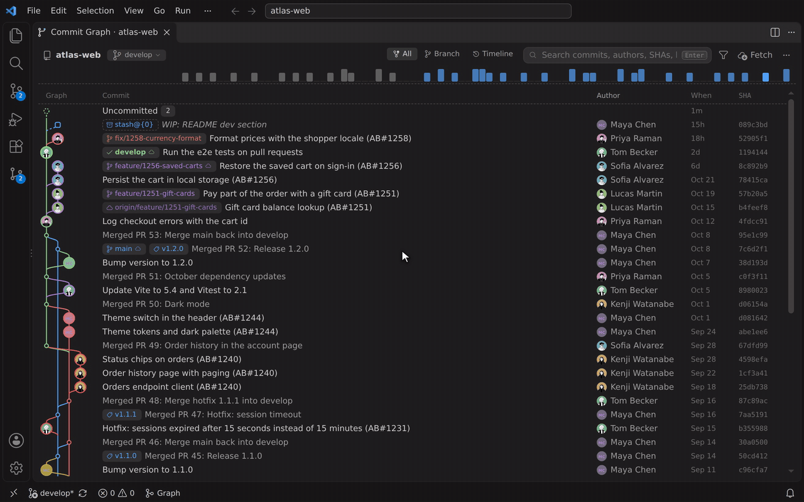
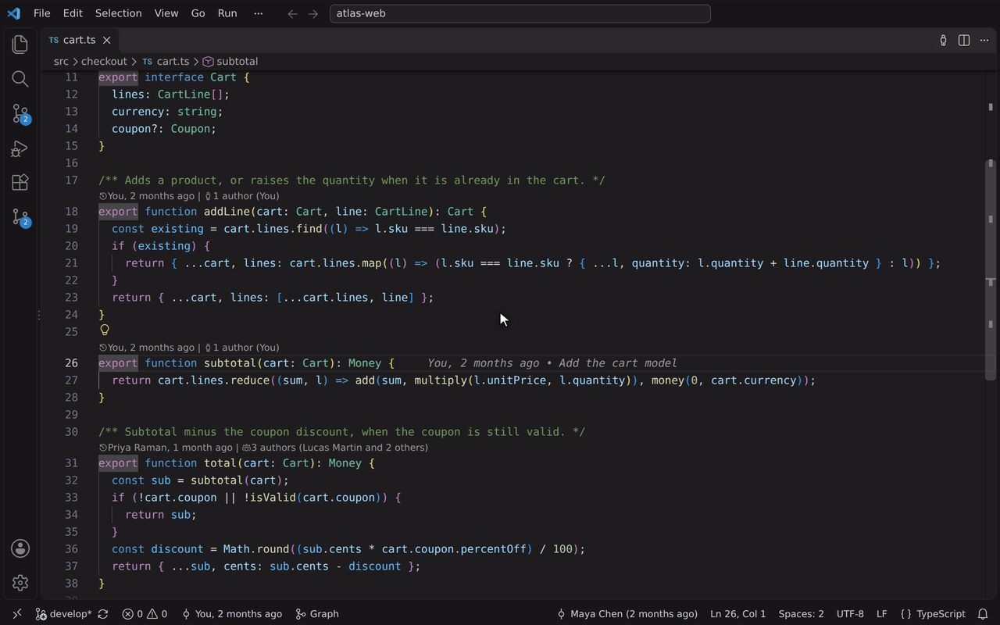
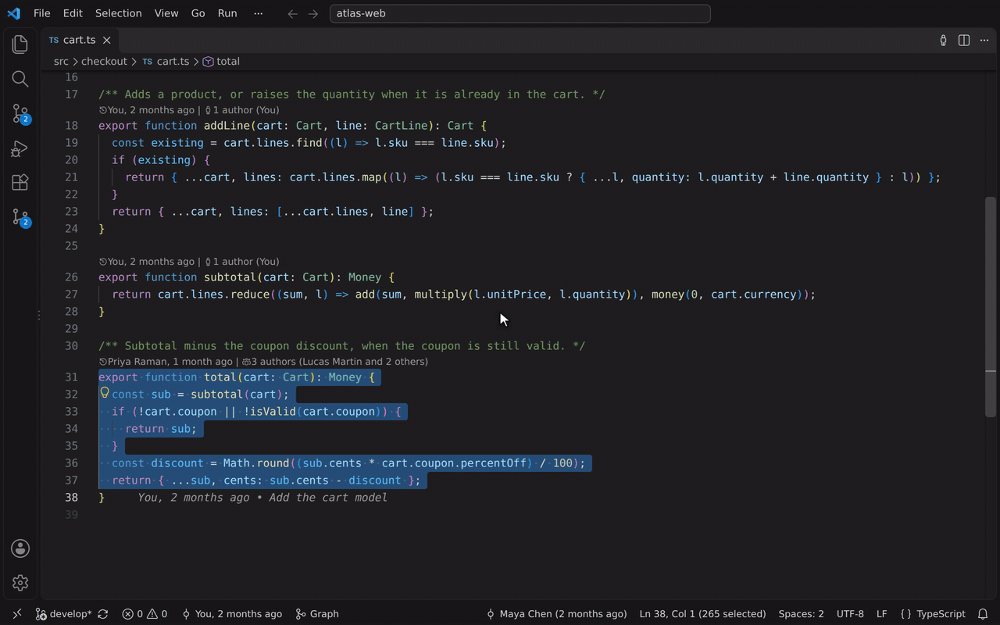
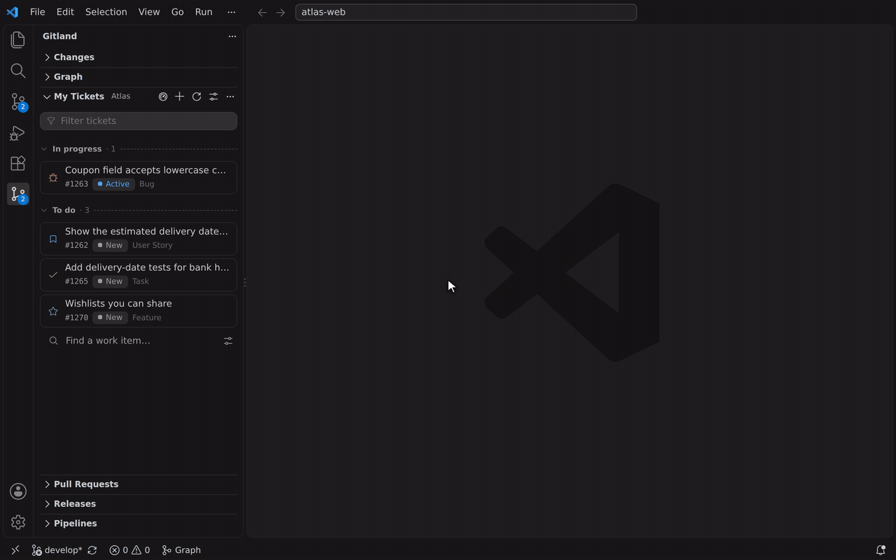
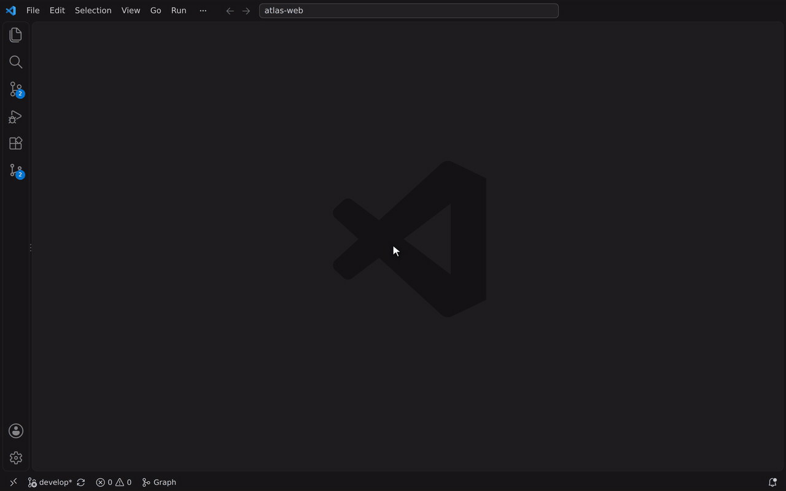

# Gitland

**Git superpowers for VS Code, built for Azure DevOps.** A beautiful commit graph, blame that knows which pull request brought each line, and your tickets, pull requests and pipelines right next to the code. Works with GitHub, GitLab and Jira too. Free, no account, no subscription.




## Why Gitland

- **Azure DevOps is a first-class citizen**, not an afterthought: work items, pull requests with votes and threads, Azure Pipelines, profile photos, `AB#1234` links.
- **Everything is free.** The commit graph, the PR review, the dashboard: no paid tier, no sign-up.
- **Your tickets drive your branches.** Pick a work item, and Gitland creates the branch, links the ticket and opens the draft pull request.
- **Looks at home in VS Code.** Every view follows your theme (dark, light, high contrast) and your font.

## Tour

### A commit graph you can read

Lanes colored by branch kind, PR and CI badges on each branch, author pictures, an activity minimap. Click a branch to focus on it, switch to **Timeline** to see one row per merged pull request, drag a branch onto another to merge it.

### Blame that knows the pull request



Author, age and message on the current line. Hover it for **the pull request that brought the change**, the tickets it mentions, the files it touched, and one-click actions. `Ctrl+Alt+B` shows the whole file's blame with a heat bar.

### ✨ Why is this code like this?



Select some lines, run **Explain These Lines**, and get their history: every commit that touched them, with diffs, PR and ticket chips, and an AI summary of how they got there. Uses the language models already in your VS Code (GitHub Copilot or any other provider).

### From ticket to pull request in one step



**My Tickets** lists your Azure Boards work items (or GitHub / GitLab issues, or Jira). *Start work* names the branch after the ticket (`feature/1262-show-the-estimated-delivery-date`), creates it from the base you pick, and can push it and open a **draft pull request** linked to the ticket.

### Compare, then write the release notes for you


Compare two tags, branches or commits: the pull requests merged, the commits on each side, the files changed. ✨ **Release notes** are written in the style of your `CHANGELOG.md`, ready to copy or insert.

### What needs you, and the review right there



The **Dashboard** shows the pull requests waiting for your review, failing CI, your tickets and the state of your branches. Open a pull request to read it, check out its branch, see its CI, vote, comment and resolve threads, without leaving VS Code.

### And also

- **Changes view** with ✨ commit messages written from the diff, the branch's ticket as a chip, amend, commit & push.
- **Interactive rebase** by drag and drop, a conflict assistant, **branch cleanup** (merged, gone, stale), **worktrees**.
- **Pipelines**: runs of your branch, jobs, steps and the failing log; rerun or cancel.
- **Search Everywhere** (`Ctrl+Alt+Shift+F`): branches, tags, commits, code added or removed, pull requests and tickets.
- **Releases**: tags with what each one shipped, the next version suggested, annotated tag + notes in one step.
- Signed commits, commit hooks, CodeLens, file and line history, and a settings page with every option.

The complete list, view by view: **[docs/features.md](docs/features.md)**.

## Works with

| | Azure DevOps | GitHub | GitLab | Jira |
|---|:---:|:---:|:---:|:---:|
| Commit graph, blame, history, compare | ✓ | ✓ | ✓ | n/a |
| Pull requests: list, create, review | ✓ | ✓ | ✓ (merge requests) | n/a |
| Tickets and *Start work* | ✓ Azure Boards | ✓ Issues | ✓ Issues | ✓ Cloud and Server |
| CI status and pipelines | ✓ Azure Pipelines | ✓ Actions | ✓ GitLab CI | n/a |

Jira replaces the host's tickets; pull requests and pipelines stay on your code host.

## Get started

1. Install **Gitland** and open a Git repository.
2. Click the **Gitland** icon in the activity bar, or **Graph** in the status bar.
3. The first time Gitland needs your host, it asks you to sign in: your Microsoft work account for Azure DevOps, VS Code's GitHub sign-in, a token for GitLab or Jira. Tokens are kept in VS Code's secret storage.

Sign-in details, personal access tokens and settings: **[docs/setup.md](docs/setup.md)**.

## Develop

```sh
npm install
npm run watch        # then F5 in VS Code ("Run Gitland")
npm run package      # builds gitland-x.y.z.vsix
code --install-extension gitland-0.1.0.vsix   # version from package.json
```

The GIFs above are recorded from a real VS Code on a fictional repository, with a stand-in Azure DevOps (`test/demo/`). After a UI change, `npm run demo` records them again (`npm run demo -- graph blame` for some of them).
